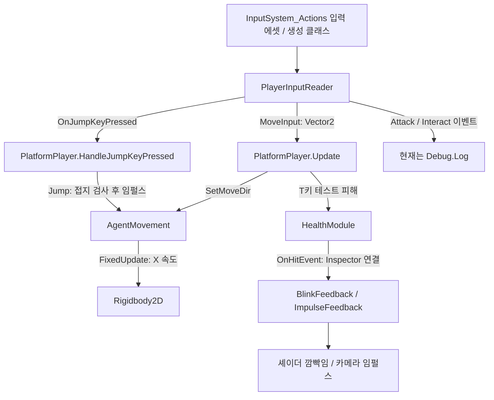

# 플랫포머 개발 진도 및 코드 구현 분석 보고서

작성 기준: 2026년 11월 9일 / 로컬 브랜치 `Tae` / 커밋 `80bc23e23e618b8d0a95931172524d96a48ac575`

분석 대상: `C:/Unity/EngineTeamPro`의 현재 저장된 Unity 코드, 프리팹, 씬, 입력 에셋, 관련 테스트 및 Git 변경 이력. 별도의 `ChainArm` HTML 프로토타입은 부록에서 구분했다. 다른 브랜치나 원격 저장소의 미반영 작업은 포함하지 않았다.

## 1. 현재 어디까지 진행됐는가

**Unity 플랫포머는 입력·좌우 이동·접지 점프·방향 전환·체력 및 피격 연출의 기반을 마련한 초기 조작 프로토타입 단계다.** 공격과 상호작용 입력은 들어오지만 실제 행동으로 연결되지 않는다. 테스트 씬에는 삭제된 스크립트 참조가 남아 있어, 통합된 플레이 구간의 완성이나 정상 실행까지 확인된 상태로 평가할 수 없다.

특히 최신 커밋 `80bc23e`에서 옷장, 장비 데이터, 무기, 상호작용 관련 코드가 삭제됐다. 남아 있는 옷장 문서와 테스트를 현재 구현의 증거로 사용하면 진도를 과대평가하게 된다. 삭제가 기획 변경인지 재구현 준비인지는 코드 이력만으로 판단할 수 없다.

완료 기준과 전체 기능 명세가 없으므로 전체 개발률을 임의의 백분율로 제시하지 않았다. 대신 다음 네 단계로 평가했다.

| 단계 | 이번 보고서의 통과 기준 | 현재 판단 |
|---|---|---|
| 1. 조작 기반 | 입력·이동·점프·체력 코드와 플레이어 프리팹이 존재 | 코드 기반 마련 |
| 2. 테스트 씬 통합 | 누락 참조 없이 실행하고 조작·피격을 재현 가능하게 검증 | 미확인, 정적 검사에서 누락 참조 발견 |
| 3. 플레이 구간 | 이동 → 상호작용/전투 → 실패·재시작 또는 목표 도달이 연결 | 아직 연결되지 않음 |
| 4. 배포 검증 | 실제 플레이 씬을 포함한 빌드와 회귀 검증 | 아직 확인되지 않음 |

현재 위치는 **1단계의 코드 기반을 마련했고, 2단계의 씬 정리와 실행 검증이 필요한 상태**다. 이 네 단계는 분석을 위한 기준이며 프로젝트에서 합의한 마일스톤은 아니다.

## 2. 기능별 진도

아래의 ‘구현’은 코드·에셋 확인을 뜻한다. Unity Play Mode에서 이번에 동작을 재검증했다는 의미는 아니다.

| 기능 | 현재 확인된 구현 | 진행 상태 | 남은 내용 |
|---|---|---|---|
| 입력 수집 | New Input System 콜백과 이동값 보관 | 기반 구현 | 비활성화·재활성화 및 기기별 실행 검증 |
| 좌우 이동 | 물리 스텝마다 X 속도를 직접 지정 | 기본 구현 | 조작감 조정 및 다른 이동 효과와의 우선순위 |
| 점프 | 접지 박스 검사 후 Y축 임펄스 적용 | 기본 구현 | 점프 버퍼·코요테 타임·가변 높이는 없음 |
| 추가 중력 | 공중 체류 시간이 일정 값을 넘으면 아래 방향 힘 적용 | 기본 구현 | 물리 갱신 시점과 프레임률 영향 검증 |
| 좌우 방향 전환 | 플레이어 루트를 Y축 0도/180도로 회전 | 기본 구현 | 비주얼과 물리 계층을 함께 돌리는 방식 검토 |
| 체력 | 초기화·피해·체력 변경·사망 이벤트 | 공용 모듈 구현 | 플랫포머의 사망 처리 연결 |
| 피격 연출 | 피격 이벤트에 깜빡임·Cinemachine 임펄스 연결 | 에셋 연결 존재 | 반복 피격 및 실제 카메라 반응 검증 |
| 공격 | 입력 이벤트와 로그, 사거리 Gizmo | 입력 연결 단계 | 대상 판정·피해·주기·공격 연출 |
| 상호작용 | Hold 입력 이벤트와 로그 | 입력 연결 단계 | 현재 런타임 상호작용 대상/선택 로직 없음 |
| 옷장·장비 교체 | 과거 문서·테스트·씬 및 데이터 에셋 잔존 | 최신 코드에서 제거됨 | 유지할 기능인지 결정 후 복구/정리 |
| 카메라 | TestMove의 Cinemachine 추적 대상·임펄스 리스너 설정 | 씬 설정 존재 | 실제 추적·피격 연출 확인 |
| 스테이지·리스폰 | TestMove의 StageManager 참조는 있으나 클래스 삭제 | 현재 경로 없음 | 실패·재시작·완료 조건 |
| 플레이어 애니메이션 | 현재 컨트롤러에 Animator 상태 갱신 없음 | 연결 미구현 | 이동·점프·피격 상태와 연출 연결 |
| 벽 점프·대시·사슬 이동 | Unity 플랫포머 컨트롤러에 해당 경로 없음 | Unity에는 미구현 | 요구 기능으로 채택할 경우 별도 구현 |
| 빌드 진입 | Build Settings에는 SampleScene 한 개만 활성화 | 테스트 씬 미포함 | 실제 진입 씬 구성 및 빌드 검증 |

## 3. 코드 구조와 실행 흐름

핵심 코드는 입력 해석, 플레이어 조정, 물리 이동, 체력을 컴포넌트로 나눈 구조다. `PlatformPlayer`가 각 컴포넌트를 찾아 연결하며, 입력 장치의 세부 처리는 `PlayerInputReader`가 담당한다.



이 구조의 장점은 이동 코드가 키보드의 A/D나 Space를 직접 알 필요가 없다는 점이다. 입력 바인딩을 바꿔도 `AgentMovement`의 이동 계산은 유지할 수 있다. 반면 현재 플레이어의 행동 허용 여부를 관리하는 로직은 별도로 없어서, 사망·UI 열림·넉백 같은 상황에 대한 이동 제한은 아직 연결되지 않았다.

### 3.1 PlayerInputReader: 입력을 값과 이벤트로 변환

근거: [PlayerInputReader.cs](C:/Unity/EngineTeamPro/Assets/01.Scripts/TAE/PlayerInputReader.cs:7), [입력 정의](C:/Unity/EngineTeamPro/Assets/InputSystem_Actions.inputactions), [자동 생성 클래스](C:/Unity/EngineTeamPro/Assets/InputSystem_Actions.cs:1).

`PlayerInputReader`는 `InputSystem_Actions.IPlayerActions`를 구현한다. `Awake()`에서 생성 클래스를 인스턴스화하고 콜백을 자신에게 등록한다. 활성화 시 입력을 켜고 비활성화 시 끈다.

```csharp
private void Awake()
{
    _controls = new InputSystem_Actions();
    _controls.Player.SetCallbacks(this);
}

public void OnMove(InputAction.CallbackContext context)
{
    MoveInput = context.ReadValue<Vector2>();
}

public void OnJump(InputAction.CallbackContext context)
{
    if (context.performed)
        OnJumpKeyPressed?.Invoke();
}
```

위 코드는 해당 클래스의 실제 메서드 발췌다. 이동은 계속 읽을 수 있는 `Vector2` 속성에 저장하고, 점프·공격·상호작용은 `Action` 이벤트로 전달한다. 버튼 이벤트는 `performed` 단계에서만 발생하므로 시작·진행·취소 콜백마다 같은 동작을 반복 호출하지 않는다.

| 액션 | 주요 바인딩 | 현재 코드에서의 소비 |
|---|---|---|
| Move | WASD, 방향키, 게임패드 왼쪽 스틱 등 | X값으로 좌우 이동, 좌우 방향 전환 |
| Jump | Space, 게임패드 아래 버튼 등 | 접지 조건을 만족하면 점프 |
| Attack | 마우스 왼쪽, 게임패드 왼쪽 버튼 등 | ‘공격’ 로그 |
| Interact | Enter, E, 게임패드 위 버튼 | Hold 완료 후 ‘상호작용’ 로그 |
| Look / Crouch / Previous / Next / Sprint | 입력 에셋에 정의됨 | 콜백 본문이 비어 있음 |

상호작용은 입력 에셋 자체가 `Hold`로 설정돼 있다. 따라서 현재도 E/Enter를 누르는 즉시 호출되는 구조가 아니라, 유지 조건을 만족해 `performed`가 됐을 때 이벤트가 발생하는 구조다. 옷장 코드가 삭제됐다고 입력 에셋의 Hold 설정까지 삭제된 것은 아니다.

`InputSystem_Actions.cs`는 Input System 1.19.0이 생성한 코드다. 직접 작성한 입력 어댑터인 `PlayerInputReader`와 구분해야 한다. 생성 코드에는 UI 액션도 있으며 현재 `_controls.Enable()`은 생성된 전체 입력 에셋을 활성화한다.

수명주기 정리에서 남은 부분은 생성한 `_controls`의 `Dispose()` 호출이 없다는 점이다. 활성·비활성 관리는 있으나 파괴 시 자원 정리까지 구현된 것은 아니다.

### 3.2 PlatformPlayer: 입력과 기능 컴포넌트를 연결

근거: [PlatformPlayer.cs](C:/Unity/EngineTeamPro/Assets/01.Scripts/TAE/PlatformPlayer.cs:21).

`Awake()`에서 동일 오브젝트의 입력·체력과 자식의 이동 컴포넌트를 찾는다.

```csharp
InputCompo = GetComponent<PlayerInputReader>();
MoveCompo = GetComponentInChildren<AgentMovement>();
HealthCompo = GetComponent<HealthModule>();
```

`OnEnable()`에서 점프·상호작용·공격 이벤트를 구독하고, `OnDisable()`에서 같은 핸들러를 해제한다. 이벤트 연결을 활성화 구간에 맞춰 관리한 점은 재활성화 시 중복 구독을 방지하는 기반이다.

`Update()`는 다음 세 가지를 수행한다.

1. `MoveInput`을 `AgentMovement.SetMoveDir()`에 전달한다.
2. 키보드 T를 이번 프레임에 눌렀으면 `HealthModule.TakeDamage(1)`을 호출한다.
3. 이동 X값을 기준으로 방향을 전환한다.

T키는 실제 적 공격이 아니라 체력과 피격 연출을 확인하기 위한 직접 피해 입력이다. 이 코드가 있다고 적과의 접촉 피해나 전투 연결이 완료된 것으로 볼 수 없다.

방향 전환은 다음 방식이다.

```csharp
private void FlipController(float value)
{
    if (value != 0)
        transform.eulerAngles = value > 0f ? Vector3.zero : new Vector3(0, 180, 0);
}
```

오른쪽 입력이면 루트 회전을 0도, 왼쪽이면 Y축 180도로 지정한다. 입력이 0이면 회전을 덮어쓰지 않아 마지막 방향을 유지한다. `SpriteRenderer.flipX`가 아니라 플레이어 루트 전체를 돌리므로 자식 무기·체커 등의 Transform도 이 방향 체계를 따른다. 현재 필드로 선언한 `spriteRenderer`는 이 함수에서 사용되지 않는다.

점프 핸들러는 `MoveCompo.Jump()`를 호출한다. 공격·상호작용 핸들러의 현재 본문은 다음과 같다.

```csharp
private void HandleInteractKeyPressed()
{
    Debug.Log("상호작용");
}

private void HandleAttackKeyPressed()
{
    Debug.Log("공격");
}
```

`attackRange`와 `_whatIsEnemy` 필드도 존재하지만, 현재 사거리 값은 `OnDrawGizmos()`의 원 표시에서만 사용되고 적 레이어는 공격 판정에 사용되지 않는다. 따라서 ‘사거리와 적 마스크를 가진 공격 시스템’보다 ‘공격을 붙일 입력 지점과 디버그 표시가 준비됨’이 정확한 설명이다.

### 3.3 AgentMovement: 이동, 점프, 접지와 추가 중력

근거: [AgentMovement.cs](C:/Unity/EngineTeamPro/Assets/01.Scripts/TAE/AgentMovement.cs:24).

이 컴포넌트는 자식 오브젝트에 위치하지만, 물리 본체는 다음 코드로 최상위 Transform에서 찾는다.

```csharp
rb = transform.root.GetComponent<Rigidbody2D>();
```

현재 프리팹처럼 플레이어가 최상위에 있을 때는 루트 Rigidbody2D를 사용한다. 추후 플레이어를 다른 부모 아래 넣으면 `transform.root`가 달라질 수 있으므로 재사용 시 주의할 구조적 가정이다.

**좌우 이동**은 입력 방향을 저장한 뒤 `FixedUpdate()`에서 적용한다.

```csharp
public void SetMoveDir(Vector2 moveDir)
{
    this.moveDir = moveDir;
}

private void FixedUpdate()
{
    rb.linearVelocityX = moveDir.x * moveSpeed;
}
```

계산식은 `수평 속도 = 이동 입력 X × 이동 속력`이다. 가속도를 누적하지 않고 매 물리 스텝의 X 속도를 덮어쓴다. 따라서 입력을 놓으면 다음 물리 스텝에서 X 속도가 0이 되고 반대 입력도 즉시 반영된다. Y 속도는 직접 덮어쓰지 않아 점프와 중력 처리를 분리한다. 공중에서도 같은 X 속도 지정이 적용되며 지상·공중 이동 속력 구분은 없다.

이 방식은 기본 조작이 단순한 대신, 나중에 Rigidbody2D 기반 수평 넉백이나 대시를 추가하면 다음 `FixedUpdate()`가 그 속도를 덮어쓸 수 있다. 현재 효과 시스템의 Transform 트윈 넉백 역시 물리 이동과 병행할 규칙이 필요하다. 실제 충돌 현상을 이번에 재현했다는 뜻은 아니다.

**점프와 접지**는 다음과 같다.

```csharp
public void Jump()
{
    if (!CheckGround()) return;
    rb.AddForceY(jumpForce, ForceMode2D.Impulse);
}

private bool CheckGround()
{
    return Physics2D.OverlapBox(checker.position, checkerSize, 0f, whatIsGround) != null;
}
```

발밑의 `checker` 위치에서 회전하지 않은 박스를 검사하고 Ground 마스크의 Collider2D가 하나라도 겹치면 점프를 허용한다. 점프는 Y 속도를 고정값으로 설정하는 방식이 아니라 임펄스를 더하는 방식이다. 점프 시점의 기존 Y 속도와 질량에 영향을 받는다. 점프 소비 플래그나 접지 이탈을 기다리는 잠금은 없고, 허용 여부를 그 순간의 겹침 검사에 맡긴다.

입력 전에 착지할 때까지 기다려 주는 점프 버퍼, 발판을 벗어난 직후의 점프를 허용하는 코요테 타임, 키를 일찍 떼면 낮게 뛰는 가변 점프는 현재 Unity 코드에 없다.

**추가 중력**은 `Update()`의 두 메서드가 담당한다.

```csharp
private void CalculateAirTime()
{
    if (!CheckGround())
        _timeInAir += Time.deltaTime;
    else
        _timeInAir = 0f;
}

private void ApplyExtraGravity()
{
    if (_timeInAir > gravityDelay)
        rb.AddForceY(-extraGravity);
}
```

접지하지 않은 시간을 누적하고 지연값을 초과하면 아래로 힘을 준다. 이는 ‘낙하 중에만 중력을 강화’하는 조건이 아니다. Y 속도의 부호를 검사하지 않아 상승 중에도 지연 시간이 지나면 적용한다. 기본 Rigidbody2D 중력을 대체하지 않고 추가 힘을 더한다.

또한 수평 이동은 `FixedUpdate()`인데 이 힘은 `Update()`에서 호출된다. 렌더 프레임과 물리 스텝 사이 호출 수가 달라질 수 있으므로, 동일 조작의 점프 궤적이 프레임률에 따라 달라지는지 실행 검증이 필요하다. 이 부분은 코드 구조에서 확인한 위험이며 실제 프레임률별 오차를 측정한 결과는 아니다.

### 3.4 HealthModule: 피해와 표시·사망 이벤트를 분리

근거: [HealthModule.cs](C:/Unity/EngineTeamPro/Assets/01.Scripts/TAE/Modules/HealthModule.cs:21).

체력은 공용 `Agents.HealthModule`이 관리한다. `Awake()` 또는 첫 `CurrentHealth` 접근에서 초기화를 보장하고 `ResetHealth()`가 최대 체력을 최소 1로 보정해 체력을 채운다. 프리팹에 `currentHealth: 0`이 저장돼 있어도 이 초기화 때문에 바로 사망한 상태로 시작한다고 단정할 수 없다.

피해 처리 순서는 다음과 같다.

1. 피해가 0 이하이거나 이미 사망했으면 무시한다.
2. `SetHealth(currentHealth - damage, true)`로 체력을 변경한다.
3. 체력을 `0 ~ maxHealth`로 제한한다.
4. 값이 바뀌면 `OnHealthChanged(previous, next)`를 발행한다.
5. 피해 변경이면 `OnHitEvent`를 호출한다.
6. 양수에서 0으로 바뀌면 `OnDead`를 호출한다.
7. 선택적 `hitEffect`와 효과 매니저가 있으면 공용 피격 연출도 실행한다.

회복·초기화와 피해를 구분하기 때문에 `ResetHealth()` 자체가 피격 깜빡임을 발생시키는 구조는 아니다. 체력 감소 이벤트, UI용 체력 변경 이벤트, 사망 이벤트를 분리해 후속 기능을 붙일 수 있게 했다.

다만 `PlatformPlayer`는 `OnDead`를 구독하지 않고, `Update()`와 점프 핸들러에도 사망 여부 검사가 없다. **체력이 0이 되는 기능과 사망 후 조작 차단·리스폰은 별도이며, 후자는 아직 연결되지 않았다.**

### 3.5 피격 피드백: Inspector 이벤트로 연출 연결

근거: [플레이어 프리팹 피격 이벤트](C:/Unity/EngineTeamPro/Assets/03.Prefabs/TAE/Player_Platformer.prefab:155), [BlinkFeedback.cs](C:/Unity/EngineTeamPro/Assets/01.Scripts/TAE/FeedbackSystem/BlinkFeedback.cs:17), [ImpulseFeedback.cs](C:/Unity/EngineTeamPro/Assets/01.Scripts/TAE/FeedbackSystem/ImpulseFeedback.cs:11).

플레이어 프리팹의 `OnHitEvent`에는 `BlinkFeedback.CreateFeedback()`과 `ImpulseFeedback.CreateFeedback()`이 직접 연결돼 있다.

`BlinkFeedback`은 `MaterialPropertyBlock`에 셰이더 속성 `_BlinkValue`를 1로 넣고, 코루틴에서 설정된 시간 후 0으로 되돌린다. 렌더러마다 머티리얼을 새로 만드는 대신 속성 블록으로 피격 표시를 바꾸는 구조다. `WaitForSeconds`를 `Awake()`에서 생성해 재사용한다.

`ImpulseFeedback`은 `CinemachineImpulseSource.GenerateImpulseWithVelocity(velocity)`를 호출한다. TestMove의 Cinemachine 카메라에는 ImpulseListener도 존재한다. 즉 체력 이벤트에서 카메라 흔들림으로 이어지는 에셋 연결은 준비돼 있다.

공용 `FeedbackPlayer`는 같은 오브젝트의 `AbstractFeedback`들을 모아 한꺼번에 재생·정지할 수 있다. 그러나 해당 플레이어의 피격 이벤트는 이 집계 메서드가 아니라 개별 피드백 두 개를 직접 호출한다. ‘피드백 집계 클래스가 있음’과 ‘현재 피격이 그 클래스를 경유함’을 구분해야 한다.

깜빡임은 연속 피격 시 기존 코루틴을 종료하지 않고 새 코루틴을 시작한다. 먼저 시작한 코루틴이 나중 피격의 깜빡임을 일찍 종료할 수 있으며, `FinishFeedback()`도 속성을 0으로 되돌리지는 않는다. 반복 피격과 도중 중단은 후속 확인 항목이다.

### 3.6 턴 전투·보스 시스템과 플랫포머의 연결 범위

근거: [BattleUnit.cs](C:/Unity/EngineTeamPro/Assets/01.Scripts/TAE/BattleUnit.cs:8), [Attacker.cs](C:/Unity/EngineTeamPro/Assets/01.Scripts/TAE/Attacker.cs:10), [PlayerAttack.cs](C:/Unity/EngineTeamPro/Assets/01.Scripts/TAE/PlayerAttack.cs:10), [KTH_Boss.cs](C:/Unity/EngineTeamPro/Assets/01.Scripts/KTH/Boss/KTH_Boss.cs:4).

플랫포머 프리팹에도 `BattleUnit`과 `Attacker`가 붙어 있다. `BattleUnit`은 체력·공격 컴포넌트를 캐싱하고 생존 여부를 제공한다. `Attacker.Attack(target)`는 유효하고 살아 있는 대상의 체력에 피해를 적용하는 공용 기능이다.

하지만 플랫포머의 공격 핸들러는 `Attacker.Attack()`을 호출하지 않는다. `PlayerAttack.Attack()`은 `TurnManager.PlayerAttack()`을 호출하는 별도 턴 전투용 경로다. **공격 모듈의 존재만으로 플랫포머 실시간 공격이 완성됐다고 볼 수 없다.**

보스 패턴·패링·넉백·히트스톱 코드도 프로젝트에 존재한다. 예를 들어 보스는 `SerializeReference` 패턴 목록을 순환 실행하고 현재 S키로 `TakeTurn()`을 호출한다. 이들은 인접 전투 기능의 진도이며, TestMove의 플랫포머 플레이 흐름 전체가 연결됐다는 증거는 아니다. 본 보고서의 플랫포머 완료 항목에 합산하지 않았다.

## 4. 프리팹과 씬은 어떻게 구성됐는가

### 4.1 플레이어 구성과 실제 파라미터

근거: [Player_Platformer.prefab](C:/Unity/EngineTeamPro/Assets/03.Prefabs/TAE/Player_Platformer.prefab:1).

```text
Player_Platformer
  PlatformPlayer / PlayerInputReader / HealthModule
  Rigidbody2D / BoxCollider2D / BattleUnit / Attacker
  ├─ Visual: SpriteRenderer
  ├─ AgentMovement
  ├─ GroundChecker
  ├─ HitFeedback
  └─ ImpulseFeedback
```

TestMove에서는 이 프리팹을 인스턴스화하고 Weapon 자식과 Interactor 컴포넌트를 추가한다. 이 두 추가 대상의 스크립트는 현재 삭제돼 있다.

| 항목 | 코드 선언값 | 현재 프리팹 저장값 | 의미 |
|---|---:|---:|---|
| moveSpeed | 3 | 10 | 실제 프리팹 이동은 Inspector 값 사용 |
| jumpForce | 5 | 15 | 질량과 기존 Y 속도에 영향을 받는 임펄스 |
| checkerSize | 별도 초기값 없음 | X 0.68 / Y 0.41 | 접지 검사 박스 |
| whatIsGround | 별도 초기값 없음 | 64, 즉 6번 레이어 | TagManager의 Ground |
| extraGravity | 별도 초기값 없음 | 10 | 공중 지연 이후 아래 방향 추가 힘 |
| gravityDelay | 별도 초기값 없음 | 0.2초 | 공중 체류 시간 기준 |
| maxHealth | 50 | 50 | 런타임 초기화 후 최대 체력 |
| Rigidbody2D 질량 / 중력 배율 | 컴포넌트 설정 | 1 / 1 | 기본 중력에 추가 힘이 겹침 |
| Attacker.damage | 10 | 10 | 현재 플랫포머 공격 입력과는 미연결 |

코드의 기본값만 보고 이동 속력이 3이라고 설명하면 현재 프리팹 설정과 다르다. 이 프로젝트는 Inspector에 저장한 값을 함께 읽어야 실제 조작 설정을 설명할 수 있다.

물리 시간 간격은 [TimeManager.asset](C:/Unity/EngineTeamPro/ProjectSettings/TimeManager.asset:6)에 `0.02`초로 저장돼 있다. 기본 물리 갱신 기준은 초당 50회다. 이 값은 부록 HTML의 초당 240회 계산과 별개다.

### 4.2 TestMove에서 확인한 구성

근거: [TestMove.unity](C:/Unity/EngineTeamPro/Assets/00.Scenes/TAE/TestMove.unity:1).

플레이어 프리팹, Ground 레이어의 사각형 발판, Cinemachine 카메라, Canvas, EventSystem, InfoUI와 몸/무기 버튼이 배치돼 있다. 카메라의 TrackingTarget은 플레이어 프리팹 인스턴스의 Transform을 참조한다. 따라서 이동·피격·과거 장비 교체를 시험하기 위한 배치가 남아 있다.

씬 인스턴스의 공격 범위는 1.81이고 적 마스크는 64다. 64는 Ground 레이어이므로 향후 이 마스크를 공격에 사용하려면 의도한 적 레이어로 수정해야 한다. 현재는 공격 코드가 이 마스크를 읽지 않아 당장의 잘못된 적 판정을 발생시키는 경로는 없다.

씬에 남은 삭제 스크립트 참조는 다음 5곳이다. 현재 Assets의 스크립트 `.meta` GUID와 삭제 전 Git의 `.meta` GUID를 대조했다.

| 씬 오브젝트 | 삭제된 클래스 | 씬 내 스크립트 참조 |
|---|---|---|
| Canvas | UIManager | [151행](C:/Unity/EngineTeamPro/Assets/00.Scenes/TAE/TestMove.unity:151) |
| StageManager | StageManager | [400행](C:/Unity/EngineTeamPro/Assets/00.Scenes/TAE/TestMove.unity:400) |
| Square (1) | InteractTest | [1052행](C:/Unity/EngineTeamPro/Assets/00.Scenes/TAE/TestMove.unity:1052) |
| Weapon | Weapon | [1277행](C:/Unity/EngineTeamPro/Assets/00.Scenes/TAE/TestMove.unity:1277) |
| 플레이어에 추가된 컴포넌트 | Interactor | [1799행](C:/Unity/EngineTeamPro/Assets/00.Scenes/TAE/TestMove.unity:1799) |

이것은 씬 파일에 유효한 대응 스크립트가 없는 참조가 남았다는 정적 확인이다. 이번에 Unity Console에서 경고를 직접 관찰한 것은 아니며, 이 참조만으로 전체 C# 컴파일 실패를 단정하지 않았다.

추가로 `Assets/04.So/TAE/UIData`의 Action·Attack·Defense·Dialogue·HealthBar·Rest·Settings 데이터 에셋 7개가 삭제된 `UIData.cs`의 GUID를 참조한다. 예: [ActionUIData.asset](C:/Unity/EngineTeamPro/Assets/04.So/TAE/UIData/ActionUIData.asset:12). 데이터 파일이 남아 있어도 현재 데이터 타입을 정상적으로 읽는 기능까지 남아 있는 것은 아니다.

플레이어 프리팹의 `m_EditorClassIdentifier`에는 예전 `Player`라는 이름이 남아 있다. 다만 `m_Script` GUID는 현재 `PlatformPlayer.cs.meta`에 정상 대응한다. 이 표기만으로 플레이어 본체를 Missing Script라고 판단하지 않았다.

### 4.3 실행·빌드 진입 상태

근거: [EditorBuildSettings.asset](C:/Unity/EngineTeamPro/ProjectSettings/EditorBuildSettings.asset:7), [SampleScene.unity](C:/Unity/EngineTeamPro/Assets/00.Scenes/SampleScene.unity:1).

Build Settings의 활성 씬은 `SampleScene.unity` 하나다. 해당 저장 씬에는 카메라와 Global Light 2D가 있고 플랫포머 플레이어 인스턴스는 없다. TestMove는 기본 씬 목록에 포함되지 않았다.

따라서 현재 Build Settings와 저장된 씬 구성을 기준으로는 TestMove의 조작 프로토타입이 기본 빌드 진입점에 연결돼 있지 않다. 별도의 빌드 스크립트나 런타임 씬 로딩으로 이를 우회하는 경로는 이번 분석에서 확인되지 않았다. 실제 실행 파일 빌드는 수행하지 않았다.

## 5. 최근 이력과 문서·테스트의 차이

| 커밋 | 날짜 | 확인한 변경 | 현재 진도에 미치는 영향 |
|---|---|---|---|
| d774eaf | 2026-11-09 | Interactor·옷장·UIData·UIManager·장비 관련 변경과 테스트 추가, StageManager 삭제 | 과거 상호작용 구현 흔적과 StageManager 잔여 참조의 배경 |
| c3ae358 | 2026-11-09 | TestMove와 UIData 에셋 변경 | 씬·에셋 설정 추가 |
| 80bc23e | 2026-11-09 | PlayerData·UIData·Interactable·Interactor·InteractTest·UIManager·Weapon 삭제, PlatformPlayer 축소 | 현재 장비·옷장·상호작용 실행 경로 제거 |

[wardrobe-minimal.md](C:/Unity/EngineTeamPro/docs/wardrobe-minimal.md:1)는 옷장에서 몸/무기를 교체하고 UI를 열면 조작을 잠그는 동작을 설명한다. 하지만 현재 `PlatformPlayer`에는 해당 장비 데이터나 UI 상태, `ChangeBody/ChangeWeapon` 메서드가 없다. 이 문서는 과거 구현 설명으로 취급해야 한다.

[WardrobeTests.cs](C:/Unity/EngineTeamPro/Tests/Wardrobe/WardrobeTests.cs:1)와 [UIManagerLifecycleTests.cs](C:/Unity/EngineTeamPro/Tests/Wardrobe/UIManagerLifecycleTests.cs:1)에는 테스트 메서드 14개가 남아 있지만 삭제된 클래스와 API를 참조한다. [실행 스크립트](C:/Unity/EngineTeamPro/Tests/Wardrobe/Run-Tests.ps1:9)가 복사하려는 필수 소스 중 7개도 현재 존재하지 않는다. 그대로 실행하면 테스트 수행에 앞서 소스 복사 단계에서 실패하는 구조다.

이 테스트들은 프로젝트 루트의 `Tests/` 아래에 있고 실행 스크립트가 별도 Unity 검증 프로젝트로 복사한다. 그러므로 테스트 소스의 누락 타입 참조가 있다는 사실을 현재 `Assets` 런타임 전체의 컴파일 오류와 동일시하면 안 된다. 반대로 과거 테스트 통과 기록을 현재 코드의 통과 결과로 인용해서도 안 된다.

## 6. 현재 남은 주요 문제와 우선순위

우선순위는 개발 진행을 막는 정도를 기준으로 정했다. 아래는 분석과 후속 제안이며 이번 작업에서 게임 코드를 수정하지 않았다.

| 우선순위 | 문제 | 근거와 영향 | 후속 작업 |
|---|---|---|---|
| 높음 | 삭제된 스크립트와 씬·데이터 불일치 | TestMove 5곳, UIData 에셋 7개 | 기능 유지 여부에 맞춰 참조와 에셋을 복구하거나 정리 |
| 높음 | 공격·상호작용의 실제 행동 없음 | 핸들러가 Debug.Log만 호출 | 다음 플레이 구간에 필요한 행동부터 연결 |
| 높음 | 사망 이후 플레이 흐름 없음 | 체력 이벤트와 컨트롤러가 미연결 | 입력/이동 차단, 재시작 또는 리스폰 연결 |
| 높음 | 테스트와 기본 빌드 진입점 불일치 | 옷장 테스트 소스 7개 누락, TestMove 미포함 | 현 사양에 맞는 테스트 및 실행 진입점 정리 |
| 중간 | 물리 힘을 Update에서 추가 | AgentMovement.ApplyExtraGravity | 물리 스텝 기준 처리로 정리하고 프레임률별 궤적 확인 |
| 중간 | 이동 속도 덮어쓰기와 외부 이동 효과의 우선순위 부재 | X 속도를 매 FixedUpdate 직접 지정 | 넉백·대시 도입 시 이동 허용 조건 및 효과 우선순위 정의 |
| 중간 | 컴포넌트·Inspector 의존성 방어 부족 | GetComponent 결과와 checker를 바로 사용 | 필수 구성 보장 및 누락 시 진단 추가 |
| 낮음 | 입력 자원 정리·피드백 반복 호출 | Dispose 미호출, 깜빡임 코루틴 중첩 | 파괴 시 정리, 반복 피격/중단 상태 정리 |
| 낮음 | 명칭과 사용하지 않는 필드 잔존 | TAE 경로의 KTH namespace, 구 Player 식별자, spriteRenderer·num 등 | 기능 정리 이후 이름과 불필요 필드 정돈 |

점프 버퍼나 대시는 현재 기능에 없지만, 전체 기획서가 없는 상황에서 필수 누락 버그라고 단정하지 않았다. 해당 기능이 목표 사양에 포함되는지에 따라 후속 범위가 달라진다.

## 7. 다음 개발을 어떤 순서로 진행할 것인가

### 첫 번째: 현재 조작 프로토타입을 검증 가능한 상태로 만들기

- 옷장·장비·상호작용의 유지 여부에 맞춰 씬 5곳과 데이터 7개를 정리한다.
- TestMove에서 플레이어, 접지 체커, 입력, 카메라, 피격 연출의 연결을 확인한다.
- 추가 중력의 물리 갱신 시점을 정리한다.
- 좌우 이동, 접지 점프, 공중 점프 거부, 반복 활성화, T키 피해를 실제 Play Mode에서 확인한다.

완료 기준: 누락 스크립트 참조가 없고, 같은 테스트 절차로 기본 조작과 피해 반응을 재현할 수 있다.

### 두 번째: 한 구간의 시작과 끝 연결하기

- 현재 로그만 있는 공격 또는 상호작용 중 플레이 구간에 필요한 행동을 구현한다.
- 체력 0 이후 입력 차단과 재시작/리스폰을 연결한다.
- 목표 지점 또는 다음 씬 진입 조건을 둔다.
- 필요한 플레이어 애니메이션과 UI를 연결한다.

완료 기준: ‘시작 → 발판 이동 → 행동 사용 → 실패 후 재시작 또는 목표 도달’을 한 구간에서 수행할 수 있다.

### 세 번째: 실행 진입점과 검증 정리하기

- 실제 진입 씬을 빌드 구성에 포함한다.
- 삭제된 기능을 전제로 한 문서와 테스트를 현 사양에 맞게 갱신한다.
- 기본 조작, 사망·복귀, 대표 행동과 씬 전환을 빌드에서 확인한다.

완료 기준: Editor와 빌드에서 동일한 진입 경로로 대표 플레이 구간을 실행할 수 있다.

## 8. 이번 분석에서 검증한 것과 한계

| 확인 방법 | 결과 | 해석 범위 |
|---|---|---|
| Git 상태·최신 이력 확인 | 분석 시작 시 작업 트리 변경 없음, 기준 커밋 80bc23e | 현재 로컬 저장본 기준 |
| 관련 C# 코드 읽기와 호출 경로 검색 | 입력·이동·체력·피드백 및 인접 전투 경로 확인 | 실행 결과와는 구분 |
| 프리팹·씬·입력·빌드 설정 읽기 | 실제 파라미터와 연결 상태 확인 | 저장된 Inspector 상태 기준 |
| 현재·삭제 전 스크립트 GUID 대조 | TestMove의 삭제 스크립트 참조 5곳 확인 | 해당 씬의 직접 스크립트 참조 검사 |
| UIData 에셋 검사 | 삭제된 타입 참조 7개 확인 | 해당 폴더의 데이터 에셋 검사 |
| Wardrobe 실행 스크립트 소스 사전 검사 | 필수 소스 7개 없음 | 테스트 실행 성공을 주장할 수 없음 |
| node ChainArm/verify.cjs | 종료 코드 0, 35개 검사 통과 | HTML의 실제 JS를 VM에서 검증, Unity와 별개 |
| Unity Play Mode·실행 파일 빌드 | 이번 분석에서는 수행하지 않음 | 조작감·물리 궤적·Console·빌드 성공 미검증 |
| 브라우저 플레이 | 이번 분석에서는 수행하지 않음 | 과거 browser-results.json을 최신 실행 증거로 사용하지 않음 |

문서 작성 외 게임 코드·씬·프리팹은 변경하지 않았다. 외부 검색 없이 로컬 소스와 설정을 근거로 작성했다.

## 부록 A. 별도 ChainArm HTML 프로토타입의 진도

근거: [README](C:/Unity/EngineTeamPro/ChainArm/README.md:1), [실제 게임 HTML](C:/Unity/EngineTeamPro/ChainArm/sanabi-chain-arm.html:49), [검증 스크립트](C:/Unity/EngineTeamPro/ChainArm/verify.cjs:1).

`ChainArm/sanabi-chain-arm.html`은 Unity Assets 외부의 독립 Canvas 게임이다. 이동, 점프, 벽 동작, 사슬 연결·스윙·접선 대시, 드론 끌어당기기, 위험물, 체크포인트, 4개 구역, 목표 구역, 카메라와 시각 효과가 구현돼 있다. 현재 Unity의 `AgentMovement`보다 행동 범위가 넓지만 Unity에 포팅된 상태는 아니다.

### 구현에서 핵심이 되는 계산

**사슬 좌표계를 통일했다.** [getGrappleFrame](C:/Unity/EngineTeamPro/ChainArm/sanabi-chain-arm.html:564)은 고정점에서 플레이어로 향하는 벡터 `(rx, ry)`와 거리 `d`를 구한다. 몸체의 오른쪽 방향은 `(ry/d, -rx/d)`이고, 이를 몸체 회전·좌우 시선·대시 방향 계산에 공통으로 사용한다. 고정점과 플레이어가 거의 겹치면 기존 회전을 사용해 0으로 나누는 상황을 피한다.

**스윙 입력은 접선 속도만 수정한다.** [updateSwingControl](C:/Unity/EngineTeamPro/ChainArm/sanabi-chain-arm.html:573)은 현재 속도와 접선 벡터의 내적으로 접선 속도를 구한다. 목표 속도 쪽으로 접근시키되 반대 입력에는 더 큰 가속 계수를 적용한다. 변경량만 접선 방향으로 더하므로 사슬 길이와 반지름 방향 운동을 별도로 관리할 수 있다. 입력이 없으면 이 제어를 하지 않아 관성이 이어진다.

**사슬은 최대 거리 제약으로 계산한다.** [물리 처리](C:/Unity/EngineTeamPro/ChainArm/sanabi-chain-arm.html:855)는 플레이어와 고정점의 거리가 사슬 길이에 도달하면 위치를 반지름 L의 원 위로 보정한다. 바깥으로 향하는 속도 성분은 제거·반발 보정하고 접선 운동을 유지한다. 사슬이 느슨할 때는 같은 제약을 강제로 적용하지 않는다.

**대시는 공통 접선 방향으로 속도를 지정한다.** [executeSwingDash](C:/Unity/EngineTeamPro/ChainArm/sanabi-chain-arm.html:605)는 벽/천장 사슬 연결과 충전 상태를 검사한다. `getDashDirection()`이 구한 방향으로 속도를 지정하고 충전을 소비한다. 고정점이나 사슬 길이를 바꾸지 않는다. 대시 직후 0.12초 제어 보호와 새 반대 입력의 예외 처리를 둔다.

**물리와 렌더 주기를 분리했다.** [gameLoop](C:/Unity/EngineTeamPro/ChainArm/sanabi-chain-arm.html:1856)는 누적 시간에서 `1/240`초씩 꺼내 물리를 계산하고 화면을 그린다. 플레이어 상태는 GROUNDED·AIRBORNE·GRAPPLING·DRONE_PULL·WALL_CLIMB 등의 문자열과 별도 타이머·플래그로 관리한다. 이는 클래스별 상태 객체를 둔 구조와는 다르다.

### 이번에 다시 실행한 검증 결과

명령 `node ChainArm/verify.cjs`를 현재 HTML에 대해 실행했고 **35개 검사가 통과**했다. 주요 항목은 다음과 같다.

- 접선 대시 방향 조합 72개에서 실제 속도·몸체 시선·예고 방향 일치 확인.
- 스윙 반전 조합 56개에서 가장 느린 반전 83ms 확인.
- 대시 후 연결 유지, 점프 버퍼·코요테 타임, 벽 이탈, 고속 충돌 검사.
- 30/60/144Hz 렌더 주기의 검사 시나리오에서 동일 이동 결과 확인.
- 4개 구역의 상태값과 그리기 실행이 유한한 값으로 유지됨을 확인.

검증은 DOM·Canvas 일부를 대체한 Node VM 환경에서 실제 게임 JS를 실행하는 방식이다. 최신 브라우저에서의 수동 플레이나 Unity Play Mode 통과를 의미하지 않는다. 부록의 기능과 통과 결과를 Unity 개발 완료 항목으로 합산하지 않아야 한다.

## 부록 B. 먼저 읽을 코드 위치

| 이해하려는 내용 | 시작 위치 |
|---|---|
| 입력 생성·콜백 연결 | [PlayerInputReader.cs:16](C:/Unity/EngineTeamPro/Assets/01.Scripts/TAE/PlayerInputReader.cs:16) |
| 플레이어 컴포넌트 조립 | [PlatformPlayer.cs:21](C:/Unity/EngineTeamPro/Assets/01.Scripts/TAE/PlatformPlayer.cs:21) |
| 입력 이벤트 구독·해제 | [PlatformPlayer.cs:28](C:/Unity/EngineTeamPro/Assets/01.Scripts/TAE/PlatformPlayer.cs:28) |
| 입력값 전달·피해 테스트 | [PlatformPlayer.cs:42](C:/Unity/EngineTeamPro/Assets/01.Scripts/TAE/PlatformPlayer.cs:42) |
| 점프 조건과 임펄스 | [AgentMovement.cs:39](C:/Unity/EngineTeamPro/Assets/01.Scripts/TAE/AgentMovement.cs:39) |
| 수평 속도 적용 | [AgentMovement.cs:45](C:/Unity/EngineTeamPro/Assets/01.Scripts/TAE/AgentMovement.cs:45) |
| 접지·공중 체류·추가 중력 | [AgentMovement.cs:56](C:/Unity/EngineTeamPro/Assets/01.Scripts/TAE/AgentMovement.cs:56) |
| 체력 변경과 피격·사망 이벤트 | [HealthModule.cs:56](C:/Unity/EngineTeamPro/Assets/01.Scripts/TAE/Modules/HealthModule.cs:56) |
| 실제 플레이어 파라미터 | [Player_Platformer.prefab:229](C:/Unity/EngineTeamPro/Assets/03.Prefabs/TAE/Player_Platformer.prefab:229) |
| 테스트 씬과 기본 빌드의 차이 | [EditorBuildSettings.asset:7](C:/Unity/EngineTeamPro/ProjectSettings/EditorBuildSettings.asset:7) |
